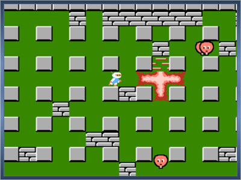

# Source code of NES game Bomberman

The same source builds either the unmodified original or a mod with a Chinese
translation (English is a build option) and new options. The mod adds:

- All in-game text is in Chinese (12px Fusion Pixel font). The BOMBERMAN
  logo and the trademark lines are unchanged.
- The CONTINUE password screen is replaced by an options screen (选项):
  stage, lives, bomb power / count, time limit, starting power-ups, and
  - 复活 (revive): losing a life keeps the stage as it is and respawns you
    in a safe spot; only when all lives are gone is the stage restarted.
  - 缓动 (slow mode): game time only passes while a direction or B is held.
  - 透视 (the bricks hiding the exit and the bonus blink between the brick
    and what they hide; they still have to be bombed) and 无敌 (invincible).
- Pause shows a message in the status bar; left / right scroll round the
  map, SELECT (or SELECT + START during play) returns to the title screen.
- Title menu: d-pad / SELECT choose, A / B / START confirm.

"开始游戏" (start) and the demo play with the original rules.

## Building

Needs [BeebAsm](https://github.com/stardot/beebasm); the mod also needs Python 3.
BeebAsm comes from the `third_party/beebasm` submodule (`git submodule update --init`).
The scripts build `third_party/beebasm/beebasm` if it is missing. Set `BEEBASM`
to use another binary instead.

Build the unmodified original, including the CONTINUE password screen:

    ./make.sh                    # USA, iNES 1.0 header
    ./make.sh . jp               # Japan, iNES 1.0 header
    ./make.sh . us 2             # USA, NES 2.0 header: identical to the No-Intro dump
    ./make.sh . jp 2             # Japan, NES 2.0 header: identical to the No-Intro dump

`make.sh [dir] [us|jp] [1|2]` always reassembles the original. It does not need
the text generator, font, configuration or any generated mod files. The ROM
is NROM (mapper 0): 16KB PRG-ROM and the original 8KB CHR-ROM.

Build the translation / options mod:

    ./build.sh                    # English, original rules for START
    ./build.sh -l zh              # Chinese
    ./build.sh -l zh -r jp        # Chinese, on the Japanese version
    ./build.sh -c config/casual.asm
    ./build.sh -H 1               # iNES 1.0 header instead of NES 2.0
    ./run-casual.sh               # Chinese, config/casual.asm, Japanese version, iNES 1.0, in ares
    ./run-ares.sh [same options]  # builds and runs it in ares (macOS)

`-c` picks the settings file used by "开始游戏" (START) and as the options
screen defaults; `config/default.asm` is the original game. `-H` picks the
header: NES 2.0 like the original dumps (default) or iNES 1.0 for old
emulators and loaders.

Both build scripts write `bomberman.nes` for USA and `bomberman_jp.nes` for
Japan, replacing the previous build of that region. `-r jp` selects the
Japanese base for the mod. The region is selected with the `REGION_JP` symbol
(`beebasm -D REGION_JP -i bman.asm` builds the original Japanese PRG),
which switches the `IF REGION_JP` blocks in bman.asm, and the CHR banks are
made from `bomber_jp.chr`. The Japanese version differs only in the title
screen (logo, copyright text, menu layout), the ending text and a few bytes of
the reset code.

`MOD` defaults to 0. `make.sh` passes `-D MOD=0`; `build.sh` passes
`-D MOD=1` to both the PRG and header assembly. Conditional blocks protect
the changed instructions and data; the unchanged code is shared. Original
headers use `NES2=0|1`; mod headers retain `INES1=0|1`.

The mod ROM is CNROM (mapper 3): 32KB PRG-ROM and four 8KB CHR banks.
The existing code stays at $C000-$FFFF; new code lives in ext.asm,
options.asm and pause.asm at $8000-$BFFF.

## Verification

    python3 tools/check.py

The check builds in temporary directories, without using or overwriting any
generated files in this checkout. It compares complete ROMs byte for byte
against these fixed reference commits:

- Original: `08c1dd3c04e9f08385f8f31e0e3f91cf2ec6f5f6` (`bm1/beebasm`).
- Mod: `000c623052804d9d81522809b3834232b5396b71` (`bm1/cn` before adding `MOD`).

It covers all 20 combinations: USA / Japan and both headers for the original;
USA / Japan, English / Chinese, default / casual settings and both headers
for the mod. It also checks the script defaults, direct original assembly
with `MOD` omitted or set to 0, and rebuilding the original after the mod.
Lengths remain 24,592 bytes for the original and 65,552 bytes for the mod.
The check exits with an error and reports the scenario and first differing
file offset if a ROM changes. It needs Git, BeebAsm and Python 3; reference
ROMs are rebuilt locally from the commits, with no external ROM files needed.

## Text

Strings are in `text/zh_strings.txt` and `text/en_strings.txt` (same IDs).
`tools/build_text.py` (run by build.sh) draws them, writes the CHR banks to
`bomber_text.chr` and the tile data to `text_data.asm`. Run
`python3 tools/build_text.py --preview` to also write PNG previews of the CHR
banks to `text/`.

The Chinese font is [Fusion Pixel Font](https://github.com/TakWolf/fusion-pixel-font)
by TakWolf, licensed under the SIL Open Font License 1.1 (see `fonts/`).
